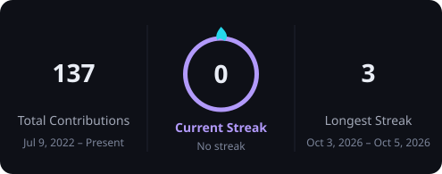
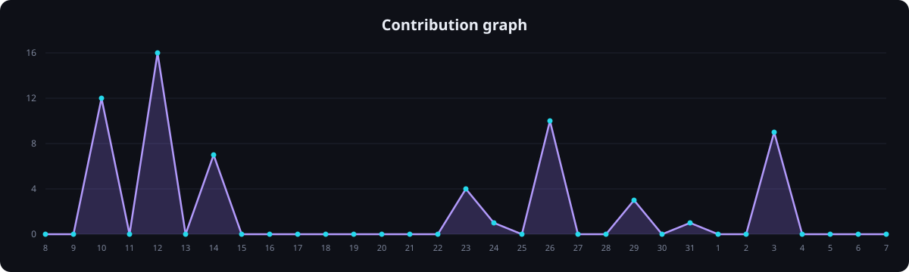

<!-- Identidad msquintana · Enlace · bg #090B10 · violeta #B29AFB→#9273EE · cian #26D8EB→#16B4DA · texto #E9EDF5 -->

<a href="https://msquintana.com">
  
</a>

<p align="center">
  <a href="https://msquintana.com">
    
  </a>
</p>

<p align="center">
  <a href="https://msquintana.com"></a>
  <a href="https://www.linkedin.com/in/msquintana"></a>
  <a href="mailto:steven@msquintana.com"></a>
</p>

<p align="center">
  
  
  
</p>


##  &nbsp;About me

<p align="center">
  
</p>

<details>
<summary><b>📄 <code>cat about_me.yaml</code></b></summary>

```yaml
name: Steven Quintana
role: Systems Engineering Student @ Universidad Mariano Gálvez
location: Guatemala 🇬🇹
focus:
  - Cybersecurity
  - Networking & IT Infrastructure
  - Cloud Computing
currently:
  - Building my skills in Linux, networking and Docker
  - Running my own domain on Cloudflare
next:
  - Cybersecurity program — IRSI scholarship (2027)
motto: "Confusion is part of the process."
```

</details>


##  &nbsp;Toolbox

<table align="center">
  <tr>
    <td align="center" width="33%">
      <b>🛡️ Security & Networking</b><br /><br />
      <br />
      
    </td>
    <td align="center" width="33%">
      <b>🐧 Systems & Infrastructure</b><br /><br />
      <br />
      
    </td>
    <td align="center" width="33%">
      <b>☁️ Cloud</b><br /><br />
      
    </td>
  </tr>
</table>


##  &nbsp;Roadmap

| Status | Goal |
| :---: | --- |
|  | Cybersecurity program — IRSI scholarship (2027) |
|  | Cisco CCST Cybersecurity |
|  | AWS Cloud Practitioner |
|  | Home lab: firewall, VLANs, SIEM & vulnerability scanning |


##  &nbsp;GitHub activity

<p align="center">
  <picture>
    <source media="(prefers-color-scheme: dark)" srcset="https://raw.githubusercontent.com/StevenQuintanaGT/StevenQuintanaGT/output/streak-dark.svg" />
    <source media="(prefers-color-scheme: light)" srcset="https://raw.githubusercontent.com/StevenQuintanaGT/StevenQuintanaGT/output/streak-light.svg" />
    
  </picture>
</p>

<p align="center">
  <picture>
    <source media="(prefers-color-scheme: dark)" srcset="https://raw.githubusercontent.com/StevenQuintanaGT/StevenQuintanaGT/output/graph-dark.svg" />
    <source media="(prefers-color-scheme: light)" srcset="https://raw.githubusercontent.com/StevenQuintanaGT/StevenQuintanaGT/output/graph-light.svg" />
    
  </picture>
</p>

<p align="center">
  <picture>
    <source media="(prefers-color-scheme: dark)" srcset="https://raw.githubusercontent.com/StevenQuintanaGT/StevenQuintanaGT/output/snake-dark.svg" />
    <source media="(prefers-color-scheme: light)" srcset="https://raw.githubusercontent.com/StevenQuintanaGT/StevenQuintanaGT/output/snake-light.svg" />
    
  </picture>
</p>


<p align="center">
  
</p>

<p align="center">
  <a href="https://msquintana.com">
    <picture>
      <source media="(prefers-color-scheme: light)" srcset="assets/brand/logo-light.svg" />
      
    </picture>
  </a>
</p>
# StevenQuintanaGT
