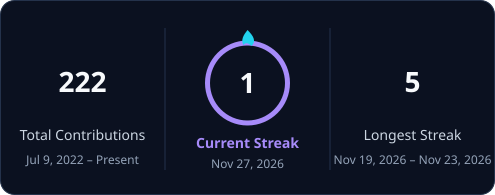
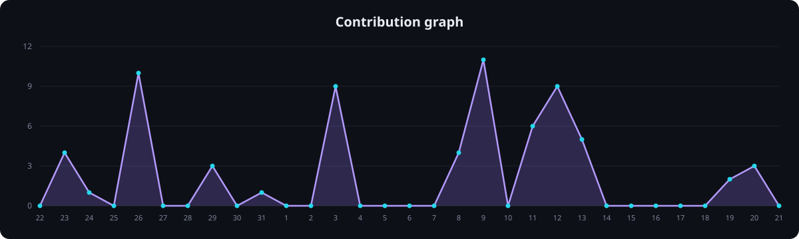

<!-- Identidad msquintana · Enlace compacto v2 (Noche abisal) · bg #070B14 · surface #0F172A · violeta #A78BFA · cian #22D3EE · éxito #34D399 · texto #F8FAFC -->

<a href="https://msquintana.com">
  
</a>

<p align="center">
  <a href="https://msquintana.com">
    
  </a>
</p>

<p align="center">
  <a href="https://msquintana.com"></a>
  <a href="https://msquintana.com/blog/"></a>
  <a href="https://www.linkedin.com/in/msquintana"></a>
  <a href="https://www.credly.com/users/steven-quintana.e0c882f2"></a>
  <a href="mailto:steven@msquintana.com"></a>
</p>

<p align="center">
  
  
  
</p>


##  &nbsp;About me

<p align="center">
  
</p>

<details>
<summary><b>📄 <code>cat about_me.yaml</code></b></summary>

```yaml
name: Steven Quintana
role: Computer Technician · Information Systems Engineering (coursework completed)
university: Universidad Mariano Gálvez de Guatemala (Jutiapa)
location: Guatemala 🇬🇹
languages:
  - Spanish (native)
  - English (intermediate)
focus:
  - Cybersecurity
  - Networking
  - Cloud Infrastructure
currently:
  - Studying Cisco CCNA 1: Introduction to Networks (Instituto RED scholarship)
  - Preparing for Cisco CCST Cybersecurity & AWS Cloud Practitioner
  - Managing DNS, email routing and hosting for msquintana.com on Cloudflare
next:
  - Cybersecurity training scholarship — IRSI (2027)
status: Open to work
motto: "Confusion is part of the process."
```

</details>


##  &nbsp;Toolbox

<table align="center">
  <tr>
    <td align="center" width="33%">
      <b>🛡️ Security & Networking</b><br /><br />
      <br />
      <br />
      
    </td>
    <td align="center" width="33%">
      <b>🐧 Systems & Infrastructure</b><br /><br />
      <br />
      <br />
      
    </td>
    <td align="center" width="33%">
      <b>☁️ Cloud</b><br /><br />
      <br /><br />
      
    </td>
  </tr>
</table>


##  &nbsp;Certifications & Roadmap

| Status | Credential / Goal | Issuer / Details |
| :---: | --- | --- |
|  | **Fortinet NSE 1 Certified in Cybersecurity** | Fortinet · *expires Nov 2028* |
|  | **Fortinet Cybersecurity and Cloud Fundamentals 1.0** | Fortinet · *2026* |
|  | **Introduction to Cybersecurity** | Cisco · *2026* |
|  | **CCNA 1: Introduction to Networks (ITN)** | Cisco Networking Academy · *Instituto RED scholarship* |
|  | **CCST Cybersecurity** | Cisco |
|  | **AWS Certified Cloud Practitioner** | AWS |
|  | **Cybersecurity training scholarship** | IRSI · *2027* |
|  | **Home lab**: firewall, VLANs, SIEM & vulnerability scanning | Personal lab |

<p align="center">
  <a href="https://www.credly.com/users/steven-quintana.e0c882f2">
    
  </a>
</p>


##  &nbsp;GitHub activity

<p align="center">
  <picture>
    <source media="(prefers-color-scheme: dark)" srcset="https://raw.githubusercontent.com/StevenQuintanaGT/StevenQuintanaGT/output/streak-dark.svg" />
    <source media="(prefers-color-scheme: light)" srcset="https://raw.githubusercontent.com/StevenQuintanaGT/StevenQuintanaGT/output/streak-light.svg" />
    
  </picture>
</p>

<p align="center">
  <picture>
    <source media="(prefers-color-scheme: dark)" srcset="https://raw.githubusercontent.com/StevenQuintanaGT/StevenQuintanaGT/output/graph-dark.svg" />
    <source media="(prefers-color-scheme: light)" srcset="https://raw.githubusercontent.com/StevenQuintanaGT/StevenQuintanaGT/output/graph-light.svg" />
    
  </picture>
</p>

<p align="center">
  <picture>
    <source media="(prefers-color-scheme: dark)" srcset="https://raw.githubusercontent.com/StevenQuintanaGT/StevenQuintanaGT/output/snake-dark.svg" />
    <source media="(prefers-color-scheme: light)" srcset="https://raw.githubusercontent.com/StevenQuintanaGT/StevenQuintanaGT/output/snake-light.svg" />
    
  </picture>
</p>


<p align="center">
  
</p>

<p align="center">
  <a href="https://msquintana.com">
    <picture>
      <source media="(prefers-color-scheme: light)" srcset="assets/brand/logo-light.svg" />
      
    </picture>
  </a>
</p>
